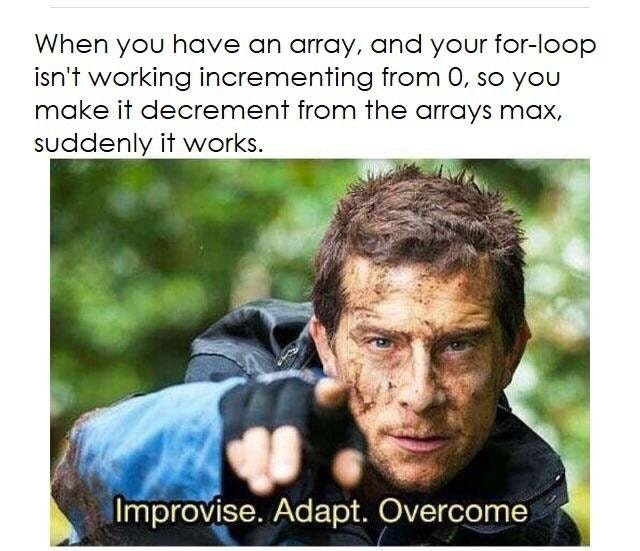

# 2-A: Selection and Iteration

## Conditions

A fundamental element of flow control is whether or not you want to execute a block of code. We use a conditional or **if statement** to test something. That test will result in a `true` or `false` value. If it's true, we'll execute the block of code. If it's false, we'll skip to the end of the block of code.&#x20;


<figure><figcaption></figcaption></figure>

<figure><figcaption></figcaption></figure>

## Loops

Loops are how we repeat commands or loop through items in a collection.&#x20;

### for loops

#### standard for loop

Most for loops look something like this:

```java
for(int x = 0; x < 20; x++) {
    // code goes in here
}
```

The for statement has a **declaration, condition** and **increment**. But you can skip the declaration if you'd like. Let's say you want the counter to have a wider scope (so it can be accessed outside of the loop) like this:

```java
int x = 0;  // declared outside the loop so it can remain afterwards
for(; x < 20; x++){
    // code goes here for the loop
}
System.out.println(x);  // will print 20
```



#### foreach loop

Let's say I have an array or collection of numbers like this: `int[] numberArray = [5, 10, 15, 20, 25];`&#x20;

Each number in that group has an address or **index** (that starts at 0). If I wanted to print the number 10 for example, I could write `System.out.println(numberArray[1]);`

So if I wanted to loop through (called iterating or traversing) all the items in this array, I could use a normal for loop like this:

```java
for (int x = 0; x < numberArray.length; x++){
    System.out.println(numberArray[x]);
}
```

But there's an easier form of the for loop that's meant to easily traverse through a collection. We'll go over some of the pros and cons of this method later.&#x20;

```java
for (int x : numberArray){
    // x isn't looping through the addresses this time
    // rather, it's pretending to be each number in the collection
    System.out.println(x); 
}
```

### while loops

#### Infinite loop

```java
while(true){
    // will never stop looping unless I use the break command
}
```

#### do-while loop

The do-while is rarely used but it's handy if you want to make sure the steps run the first time before the loop condition is tested. [Read more.](https://www.tutorialspoint.com/java/java_do_while_loop.htm)&#x20;

```java
do {
    // code will run at least one
} while(x > 10);
```



This comes up _all_ the time in problems. It's a useful trick to avoid crashing your apps, too.&#x20;



##
