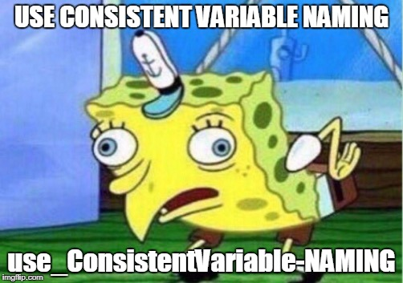

# 1-C: Data Types & Operations

## Learning Targets

* I can declare variables of common Java data types and assign values.
* I can control the flow of my app with loops, conditionals and method calls.
* I can write efficient conditionals and return comparisons in my methods.&#x20;
* I can describe the difference between logic, run time and compile time errors.&#x20;

## Declaring Variables

Primitives are objects that live entirely in stack memory (they're lowercase like **`int`** and not like **`String`**) . We'll go over the difference between stack and heap memory later. For now, just think of stack memory as the lightweight stuff that's really fast-access.  Take a look at the [types of Java primitives](https://docs.oracle.com/javase/tutorial/java/nutsandbolts/datatypes.html).

<figure><figcaption></figcaption></figure>

### Naming Conventions

`CompoundCapitalize` name of classes

`camelCase` variables and methods

`ALLCAPS` variables marked as _`final`_, meaning they can't change

`snake_case` is typically used only in Python and I miss it every time I work in Java or C#




## Operators

### Arithmetic

| Operator            | Description                                                                | <p>Example <br>(a=10, b=20) </p> |
| ------------------- | -------------------------------------------------------------------------- | -------------------------------- |
| + (Addition)        | Adds values on either side of the operator.                                | a + b will give 30               |
| - (Subtraction)     | Subtracts right-hand operand from left-hand operand.                       | a - b will give -10              |
| \* (Multiplication) | Multiplies values on either side of the operator.                          | a \* b will give 200             |
| / (Division)        | Divides left-hand operand by right-hand operand.                           | b / a will give 2                |
| % (Modulus)         | Divides left-hand operand by right-hand operand and returns the remainder. | b % a will give 0                |
| ++ (Increment)      | Increases the value of operand by 1.                                       | b++ gives 21                     |
| -- (Decrement)      | Decreases the value of operand by 1.                                       | b-- gives 19                     |

#### Integer Math

What's `9 / 4`? In Java, it's just`2`, but if you wrote it like `9.0 / 2`, then the answer would be 2.5. If you don't introduce a decimal to the operation, if you only give Java literal `int`s , it'll match that format and ignore decimals.&#x20;



### Comparison

We evaluate / test data and produce a `true` or `false` value.&#x20;

| Operator | Description              | Example (a=10, b=15) | Result |
| -------- | ------------------------ | -------------------- | ------ |
| ==       | Equality operator        | a==b                 | false  |
| !=       | Not Equal to operator    | a!=b                 | true   |
| >        | Greater than             | a>b                  | false  |
| <        | Less than                | a\<b                 | true   |
| >=       | Greater than or equal to | a>=b                 | false  |
| <=       | Less than or equal to    | a<=b                 | true   |

#### Short-Circuit Evaluation

## Arrays

You can declare and initialize an int like `int x = 5;` Similarly, you can create an array that contains three ints like this: `int[] x = {5, 10, 15};` &#x20;




Arrays are **immutable**. They don't change in size. Java uses a fancier object called an `ArrayList` that is more flexible. So if one of your friends is trying to convince you to increase the size of an array, just say no.&#x20;


### Array Tricks

```java
// Let's demonstrate some array skills!

// Here's a blank array that's got spots for five ints
int[] arr = new int[5]; 

// You can also create an array with initial values
int[] x = {5, 10, 15}; 
```

#### How long is that array?

`x.length;  // note: this isn't a method like it is in the String class.`&#x20;

#### What's the first element in the array?

`x[0];   // this will print "5" in my example`

#### What's the last element in the array?

`x[x.length-1]; // this will print "15" in my example`

#### What other skills do you need to know?

* Loop through every element in the array
* Check if an element is found in an array
* Make an array of other types of objects

## Method Calls

This is a part of **control flow**. The thread, the computer's train of thought, is being sent over to work through a set of commands called a method or function (either name works in this class).&#x20;

<figure><figcaption><p>The main function is calling max(), passing it a few numbers and saving the result</p></figcaption></figure>

<figure><figcaption><p>The variable declared in the header is scoped to that function</p></figcaption></figure>

<figure><figcaption></figcaption></figure>

