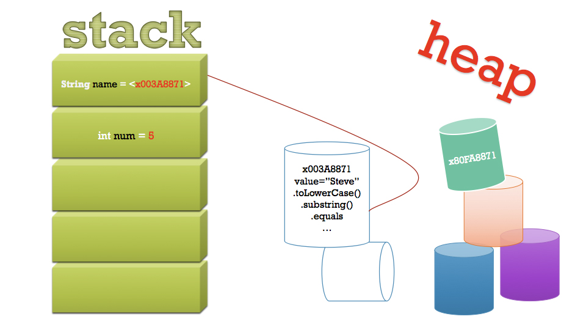
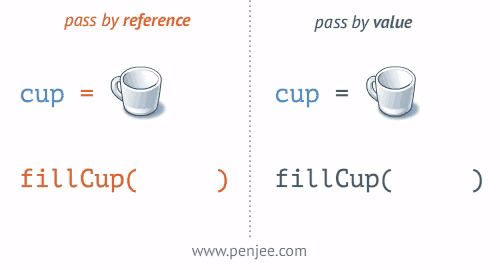

# 3-A: Class References

## Learning Targets

* I can describe what it means to be an object-oriented programmer.
* I can describe the difference between values and references.
* I can build unit tests to check every method in my class definition. &#x20;



## Class Vocab

.png>)

.png>)

.png>)

.png>)

## Object-Oriented Programming

Why don't we list all of our code in one long file? How do we start to organize big projects? We start with objects. Already we've been using a class with a main method as its starting point. All of our methods have been static. What if we wanted to make a game with a lot of monsters? We can define our own `Monster` class and create as many instances of that object as we need in the game. We can't use `static` methods anymore as a result.  &#x20;

#### Let's try out a _simple_ game in class using while-true loop and a `Monster`.&#x20;

### Encapsulation

Keep your data private, accessible only to methods that allow for more careful controls.&#x20;





### Primitives and Refs

<figure><figcaption></figcaption></figure>



```java
import java.util.ArrayList;

public class Practice {

	public static void main(String[] args) {
		
		// create a primitive
		int myPrimitive = 5;
		// pass it by value to a method that adds one to the item.

		addOne(myPrimitive);
		// print the unchanged value of the primitive
		System.out.println("Primitive: " + myPrimitive);
		
		// instantiate a list and store the reference to it in myRef
		ArrayList<Integer> myRef = new ArrayList<>();
		// add the value 5 to a new Integer 
		myRef.add(5);
		// pass it by reference to a method that adds one to the first element in the list
		addOne(myRef);
		// print what's now in the first spot of the object that was passed by reference
		System.out.println("Reference: " + myRef.get(0));
		
	} // closes main
	
	public static void addOne(ArrayList x) {
		// get the current value of the first item in the list, convert to int
		int current = (int)x.get(0);
		// set the first item's value to one more than its current
		x.set(0, ++current);
	}
	
	public static void addOne(int x) {
		++x;
	}

} // closes the class
	
```








## Intro to ArrayLists

ArrayLists are introduced in this section because they're objects themselves. They illustrate some of the differences we see when working with objects. Instead of arrays when we can access an element just by printing `someCollection[x]`, we now need to use `someOtherCollection.get(x)`. Let's get into these differences.

.png>)

.png>)

### &#x20;Different Kind of Loop

Because ArrayLists are only accessible through methods, you can use the same type of `access[index]` you can with an array. Here's what a simple traversal looks like with a good ol' array:

```java
int[] myArray = {5, 10, 15, 20};
for(int x = 0; x < myArray.length; x++){
    System.out.println(myArray[x]);
}
```

Notice how I used **length** as a property not as an accessor method() and I accessed an element from the collection using \[brackets]. Now let's take a look at an ArrayList:

```java
List myList = new ArrayList<Integer>(); 
myList.add(5);  // I could loop and add all these
myList.add(10); 
myList.add(15);  
myList.add(20);  
for(int x = 0; x < myList.size(); x++){
    System.out.println(myList.get(x));
}
```

There's a couple important things happening above you should look closely at:

* Notice how I declared a `List` and then turned it into an ArrayList? It wouldn't have worked if I tried to do `new List` because a `List` is abstract. It's like **mammal.** You can tell the computer that you'd like to make a new mammal named `x` and it should run the `new Dog()` constructor. That's a polymorphic declaration. Use a general ancestor as a type and then be more specific during the constructor.&#x20;
* If you look inside the ArrayList class programmed inside our Java library, you'll notice it has an array at its core. It's a wrapper for an array. So there is a `.length` property that's relevant to its internal, private programming. Every time you `.add(something)` to an ArrayList it destroys its old array and copies all the content to a new, longer array. So `.length` is serious business. Since that's occupied, we use the `.size()` accessor method to retrieve the length of an ArrayList.&#x20;

## SecureList: An Example

What's the point of creating our own objects? How does an ArrayList differ from an array in practical implementation? Let's go through an example project to help iIllustrate these concepts.&#x20;

### What is a SecureList?

SecureLists are made up. They're a silly object that provides an extra layer of "security" by storing your list of 12 names in two different objects, an array and an ArrayList. Does that actually provide additional security? No, not really. But let's pretend it does so you have an opportunity to work with an array and an ArrayList simultaneously.&#x20;

Let's set up your project with the following files:



```java
/*
 * To change this license header, choose License Headers in Project Properties.
 * To change this template file, choose Tools | Templates
 * and open the template in the editor.
 */

import java.util.Scanner;

public class App {
    
    // from a static method, we'll create instances of our made-up object
    public static void main(String[] args) throws Exception {
      
        System.out.println("Let's build a list of names to test.");
        Scanner s = new Scanner(System.in);
        
        // our example container
        String[] testList = new String[12];
        
        // build an example list to work with
        System.out.print("Would you like to enter names? (y/n): ");
        if(s.nextLine().equals("y")){
            // populate the array with names from user
            for(int x = 0; x < 12; x++){
                System.out.print("\nInsert name at index " + x + ": ");
                testList[x] = s.nextLine();
                System.out.println();
            }  
        } else {
            // populate the array with just numbers
            for(int x = 0; x < 12; x++){
                testList[x] = "Student #" + x;
            }  
        }        
       
        System.out.println("\n----- SecureList Unit Tests ------\n");
        
        // test the constructor
        SecureList test1 = new SecureList(testList);
        
        // test title mutator and accessor
        System.out.println("\nTITLE TEST: \n");
        test1.title("Demo"); // mutator 
        System.out.println(test1.title());  // accessor

        // implicitly call the .toString() method
        System.out.println("\nPRINT TEST: \n");
        System.out.println(test1);
        
        // draw a random name from the list
        System.out.println("\nGET RANDOM: \n");
        System.out.println(test1.getRandom());
        
        // check that each element in both collections match
        System.out.println("\nIS SECURE: \n");
        System.out.println(test1.isSecure()); // should print "true"
        
        // get the first name in the list
        System.out.println("\nGET STUDENT 0: \n");
        System.out.println(test1.getName(0));
        
        // get the first name in the list using the seat number not the index
        System.out.println("\nGET SEAT 1: \n");
        System.out.println(test1.getStudentBySeat(1));
        
        // randomize the order of the names
        System.out.println("\nSHUFFLE: \n");
        test1.shuffle();
        System.out.println(test1);
        
    }
}
```



```java
/*
 * To change this license header, choose License Headers in Project Properties.
 * To change this template file, choose Tools | Templates
 * and open the template in the editor.
 */

import java.util.ArrayList;

/**
 * Doubles the protection of your data by storing your 12 names in both an array
 * and an ArrayList
 */
public class SecureList {
    
    // ENCAPSULATED INSTANCE VARIABLES
    // a var for the title String
    
    // uninitialized String Array
     
    // uninstantiated ArrayList typecast to String
    
    
    // -----------
    // CONSTRUCTORS
    // -----------
        
    /**
     * This is the basic constructor that initializes all the instance variables
     */
    public SecureList(){
        // create a blank title
        title = "";
        // create a blank array of Strings
        nameArray = new String[12];
        // instantiate an ArrayList and then loop and add 12 blank Strings
        nameList = new ArrayList<String>();        
        for(int i = 0; i < 12; i++) nameList.add("");
    }
    
    /**
     * Extracts names from an ArrayList to store in both class containers
     * @param nameList : starting names
     */
    public SecureList(ArrayList<String> nameList){
        // call the first constructor to setup the blank stuff
        this();
        
        // copy the data from the given list
        
    }
    
    /**
     * Extracts names from an array to store in both class containers
     * @param nameArray : starting names
     */
    public SecureList(String[] nameArray){
        // call the first constructor to setup the blank stuff
        this();
        
        // copy the data from the given array
    }
    
    // -----------
    // ACCESSORS
    // -----------
    
    /**
     * Accessor method for the title instance variable
     * @return this.title
     */
    public String title(){
    
    }
    
    /**
     * After checking that the names between the two strings
     * @param n : the zero-indexed location of the name
     * @return
     */
    public String getName(int n){
        // use the isSecure method to check n
        if(!isSecure(n)){
            System.out.println("NOT SECURE");
            return null;
        }
        
        // return the name in the index location of n
        
    }
    
    /**
     * Wrapper for the getName method that is NOT zero-indexed
     * @param s: Seat location
     * @return
     */
    public String getStudentBySeat(int s){
        
    }
    
    // -----------
    // MUTATORS
    // -----------
    
    /**
     * Modify this instance's title property
     * @param title : new label for this secure list object
     */
    public void title(String title){
    
    }
    
    /**
     * Change the name of both collections at a given index location
     * @param n : index location to target
     * @param name : new name value to set
     */
    public void changeName(int n, String name){
        
    }
    
    // -----------
    // UTILITIES
    // -----------
    
    /**
     * Checks if the given index location is a blank "" string
     * @param n : index location to check
     * @return : true if the index location had a length of zero
     */
    public boolean isEmpty(int n){
        
    }
    
    /**
     * Returns the comparision between the two Strings in the container at position n
     * @param n : the zero-indexed location in the collection to check
     * @return true if the two Strings .equal
     */
    public boolean isSecure(int n){
        
    }
    
    /**
     * Traverses the length of the collection and checks in location is secure.
     * If any is found insecure, it returns false
     * @return list integrity 
     */
    public boolean isSecure(){
        // loop
            // if insecure at that postion, return false
​
        // if you make it through the loop safely, return true
    }
    
    /**
     * Draws a random index location and returns the name at that location
     * @return : the String value at a random index location
     */
    public String getRandom(){
        // generate a random number from 0 up until but not including the length
        
        // return the call to the getName method
    }
    
    /**
     * Randomizes the location of all the Strings using the Selection Shuffle
     * algorithm 
     */
    public void shuffle(){
        
    }
    
    /**
     * Traverses name collection, printing the seat location followed
     * by the name
     */
    @Override
    public String toString(){
        
    }
    
}
```






[Want some extra practice?](https://gist.github.com/dadiletta/f81511e25f59b06f5757127e8d6a201d)


