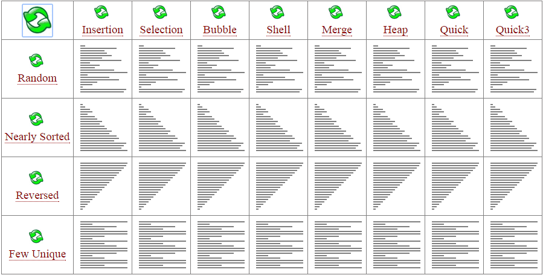
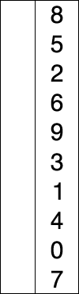
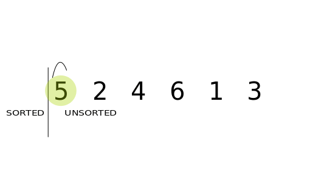

# 4-C: Sorting

## Learning Targets

* I can implement selection, insertion and merge sort algorithms.&#x20;
* I can compare sorting algorithms' efficiency.&#x20;

## Algorithms

We've talked about algorithms before, most especially around the shuffling patterns we've used in the Elevens lab.&#x20;

### Efficiency

The bigger the group of data, the more important it is to be efficient. Searching on the web or in a database needs to be awfully fast. We measure the efficiency of a complex search or sort algorithm in Big O notation.






### Searching

Let's knock out a quick algorithm first, searching. The `O(n)` way is just a straight traversal. But we could chop that down to a `O(log n)` with a binary search:



The visualization of these patterns / algorithms / methods / whatever, is surprisingly helpful. You can get a feel for how we chunk the computer's task to organize a long list of numbers.&#x20;







.png>)

.png>)

### Selection Sort

Let's start with a nested loop, a boring old `O(n^2)` traversal and sort.&#x20;



.png>)

.png>)

 (1).gif>)

.png>)

.png>)

Now between the inner and otter loops, we do a 3-part-swap

.png>)



```java
public static void selectionSort ( int[] num ){   
    // outer loop stops one early!   
    for ( int i = 0; i < num.length - 1; i++ ){      	
        //initialize the smallest_index    
	int smallest_index = i;        		
	//inner loop locates the smallest after starting one past the outer loop
	for(int j = i + 1; j < num.length; j++) {
	    // if I find a smaller number...
	    if( num[ j ] < num[ smallest_index ] )
	        smallest_index = j;    
	}     	
	// 3 part swap between loops   
	int temp = num[ smallest_index ];         	
	num[ smallest_index ] = num[ i ];     		
	num[ i ] = temp;    
    } // close the otter loop          
} // close the method

```

### Insertion Sort

Insertion sort has the same worst-case scenario efficiency as selection sort, but it has a much better best-case scenario efficiency.&#x20;



.png>)

#### Step 1: Nested loop with an inner loop traversing in reverse.&#x20;

.png>)


#### Still Step 1: The inner loop doesn't need to start at index`[0]`&#x20;

.png>)


#### Step 2: The inner loop goes backwards so long as the number that the outer loop has is bigger

.png>)

#### Step 3: You'll have to move numbers over as you go to make room

.png>)

.png>)

.png>)

.png>)

```java
public static void insertionSort(int[] nums){
    // outer loop starts one in b/c my inner loop goes bkwrds
    for(int j = 1; j < nums.length; j++){
        // start a weird 3-part-swap by backing up j
        int temp = nums[j];
        // inner loop goes backwards and it's a while loop
        // let's start the counter
        int i = j - 1; 
        // our counter can't go out of bounds AND 
        // the inner loop is looking at a number bigger than temp  
        while( i > -1 &&  nums[i] > temp ) {
           // skoootch numbers over  
           nums[i + 1] = nums[i];
           // move the inner loop counter down
           i--;
        }
        // complete the 3-way-swap, undoing the last i--
        nums[i+1] = temp;
    }
}
```


Respect the YouTube level grind.&#x20;




### Assignment

Create a class that uses `Sortable` and `IntegerMonster`.  Hopefully, that and the code below is enough for you to figure out what to do next. If not, let's make some extra time to practice/read about inheritance in Java.


You'll have to use `extends` before `implements`. \
**Potentially helpful analogy:** I imagine "extends" as the class's last name and "implements" as job titles.&#x20;




```java
interface Sortable {
    void selectionSort(boolean lowToHigh);    
    void insertionSort(boolean lowToHigh);    
}
```



```java
abstract class IntegerMonster {

  public int[] nums;
  
  public IntegerMonster(int length){
    nums = new int[length];
  }
  
  public void buildRandomArray(){
    for(int i = 0; i < nums.length; i++){
      nums[i] = (int)(Math.random() * 5000);
    }
  }
  
  public abstract void printArray();
  
}
```



 (1).gif>)

**Surprise:** Your client suddenly changes the SoW and insists that the sort methods' outer loops print the current state of the array neatly on one line. Each array during the sort should be labeled.&#x20;

## Recursion

What happens if I call a function that calls itself? You can use this as a trick to chunk information in a loop-like flow.&#x20;

```
public void recursive(){
    System.out.println("It was a dark and stormy night.");
    recursive();
}
```

.png>)

A **base case** is the critical piece of a recursive function that will terminate the recursive calls, and start the domino effect in the opposite direction.&#x20;

.png>)

If we have a base case in place (rhymes!) we can use recursion to solve some tricky problems in an elegant fashion.&#x20;

.png>)



### Merge Sort

This [article](https://www.baeldung.com/java-merge-sort) is a great follow-up to the video below.&#x20;



Let's start with some numbers to sort:

.png>)

Check if `nums` has hit its base case. Is it already split up? If not, split it up.&#x20;

.png>)

Then we send each side to mergeSort. Notice we send the left side first. And the next copy of `mergeSort` will break that side up first too--all the way down to the base case.

.png>)

But down at that last level, when they can't be broken down any further, we'll be left with a few useful ingredients, the (yellow) `nums`, the left side, **`l`**, and the right side, `r`. Now we'll shove `l` and `r` back together, in order, and overwrite the contents of `nums`. We'll do this in a separate function: `merge(nums, l, r, mid, n - mid);`

There are all sorts of variations on mergeSort and the merge function. The one from [Baeldung](https://www.baeldung.com/java-merge-sort) is pretty clever and fun to talk over. Check it out:

```java
public static void merge(
  int[] a, int[] l, int[] r, int left, int right) {
  
    int i = 0, j = 0, k = 0;
    while (i < left && j < right) {
        if (l[i] <= r[j]) {
            a[k++] = l[i++];
        }
        else {
            a[k++] = r[j++];
        }
    }
    while (i < left) {
        a[k++] = l[i++];
    }
    while (j < right) {
        a[k++] = r[j++];
    }
}
```

First notice how they include the post-operation increment, `k++` (instead of `++k`). This way, every time `k` is used, it increases the index tracker on the parent array. It's a clever touch. Meanwhile, `i` is serving similarly as the index tracker for the left side and `j` is serving the right side.&#x20;

&#x20;The first while loop proceeds until one of the counters hits their max. Then only one of the two remaining while loops will execute, collecting the last number.

### Assignment

Create a class that extends `NameManager` and implements all required methods. &#x20;

```java
abstract class NameManager {
    /** Core data structure to hold your name list */
    protected ArrayList<String> names;

    /** Adds names to the list until a blank is submitted */
    abstract void buildList();
    
    /** Uses selection shuffle algorithm */
    abstract void shuffle();
    
    /** Sorts the list of names using insertion sort */
    abstract void insertionSort();
    
    /** Sorts the list of names using selection sort */
    abstract void selectionSort();
    
    /** Sorts the list of names using merge sort */
    abstract void mergeSort();
    
    /** Returns a random name from the names list */
    abstract String pickRandom();
}
```
