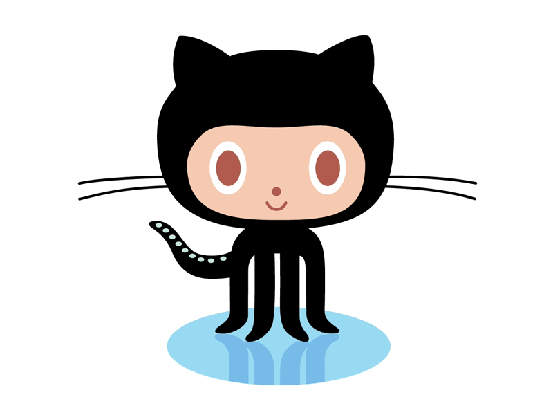

# OLD: 6: Deploying Code

## Expectations

### Learning Targets 

* I can compose a higher-ordered algorithm.&#x20;
* I can update code on my Raspberry Pi.&#x20;
* I can make short, descriptive commit messages.

### Assessments 

* Your GitHub repo will be regularly reviewed.
* You will demonstrate your capacity to control your robot.&#x20;
* You will be asked regular comprehension questions about Python and deployment.&#x20;

## Coding the project&#x20;

### Fork code

1. Visit the [project](https://github.com/dadiletta/Piggy) and **fork** it&#x20;
2. Open [Visual Studio Code](https://code.visualstudio.com) and press **CTRL + SHIFT + P**
3. Use the **git: clone** command and paste your GitHub url. You should now see your code on your editor. Explore `student.py` and `teacher.py`.&#x20;
4. Use SSH (on Mac) or [PuTTy](https://www.chiark.greenend.org.uk/~sgtatham/putty/) (on Windows) to connect to your robot
5. Remove the `Piggy` folder if it's already there: `rm -rf Piggy`
6. Now we'll clone your project on the robot too with `git clone https://github.com/YOURUSERNAME/Piggy`
7. Change to your project folder: `cd Piggy`
8. Run the app: `python3 student.py`

### Push code to GitHub

You you make changes to your app and want to update the code on your robot, we first need to send the code from our computers to GitHub.&#x20;

.png>)

### Pull code on robot

Now we'll remote control our robots using SSH. We'll use Linux commands to pull the updated code down from GitHub.&#x20;

1. Make sure you're in the right folder: `cd Piggy`
2. Pull your updated code: `git pull origin master`
3. Run your app: `python3 student.py`
4. If it doesn't run, study the error.&#x20;

## Calibrate

We'll need to configure your class variables.&#x20;

### Midpoint

If the servo wasn't mounted perfectly, the midpoint won't be `1500`. But that's rarely the case. We should adjust this [magic number](https://en.wikipedia.org/wiki/Magic_number_\(programming\)) to fit your particular robot.&#x20;

### Motor Speeds

Sometimes one motor will perform faster than the other, giving the robot a noticeable veer. We can try to correct for this drift by adjusting the motor power.

## Dance Project

Check out what commands are available from the API that's provided for you. These are the commands you're inheriting.&#x20;

### Higher-Ordered Logic

Your `dance` method should read as close to regular English as possible. The nitty-gritty commands are all kept in the particular methods being called in your `dance` algorithm. So your `dance` method should just call a handful of moves. Within those moves, you'll use the specific motor commands below and get into the nitty-gritty of robot control.&#x20;

* `deg_fwd(angle)` - how many degrees do you want your wheels to rotate? You need to pass the _angle_
* `turn_to_deg(angle)` - rotates to the given angle as calculated by the piggy's gyroscope
* `turn_by_deg(angle)` - turns relative to it's current heading. Positive values rotate right and negative rotate left
* `fwd` - powers on your robot to drive forward. You'll need to use `self.stop()` to power off the motors
* `right` - by default, `self.right()` will give the left motor 90% power and the right 0% which rotates right. You can use kwargs to adjust the power such as `self.right(primary=90, counter=-90)`, which will spin the robot in place
* `left` - same as right but reversed.
* `back` - same as fwd but in reverse.
* `servo` - moves the servo (plugged into servo1) to the given value (use 1000 - 2000)
* `stop` - sets motor power to zero
* `read_distance` - returns the distance from the distance sensor (plugged into I2C port) in millimeters
* `get_heading` - returns the gyroscope's value

