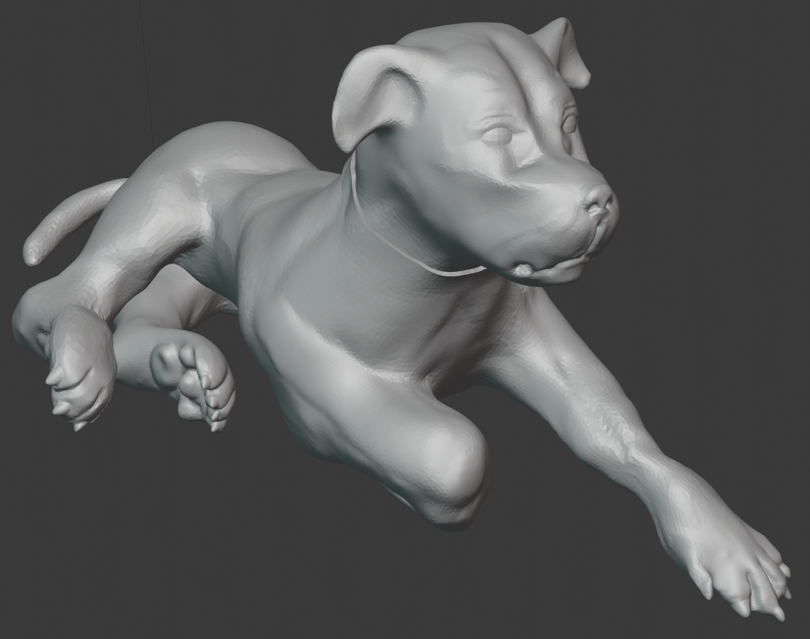

# Lesson 5: Masking, Hiding, and Working with Multiple Objects

### **Please watch all three videos today!**


Watch first:  Detail reminder



Main Lesson content



Mask Extrusion: a better way to do collars


