# Student Gallery: Animal Sculpts

Because you don't get to see each other's work as much in the online environment, I think this is a good point to start to take a look at each other's choices with the animal sculpture lessons.  They are all so different!

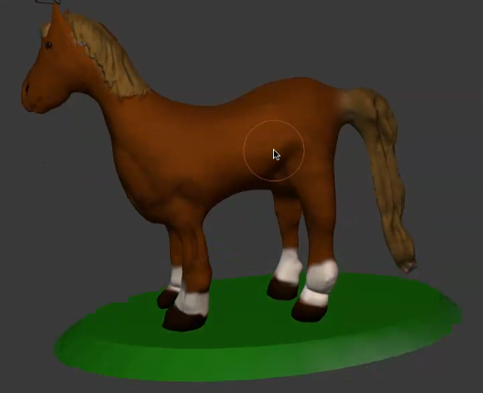

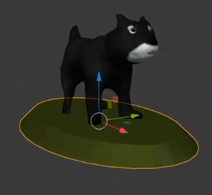

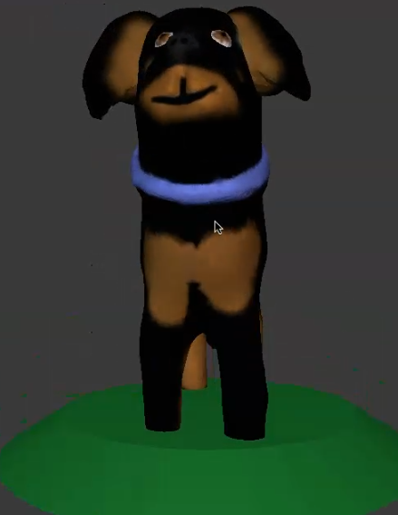

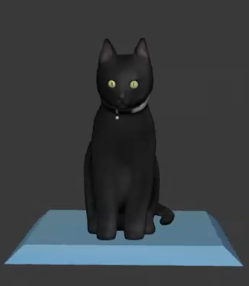

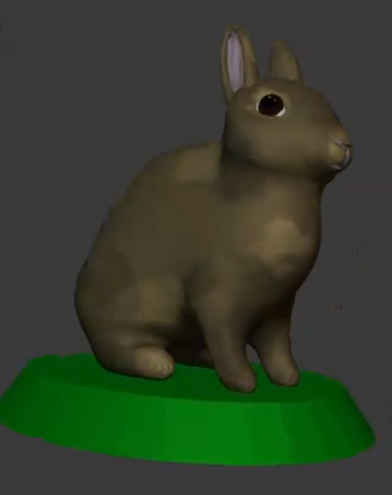

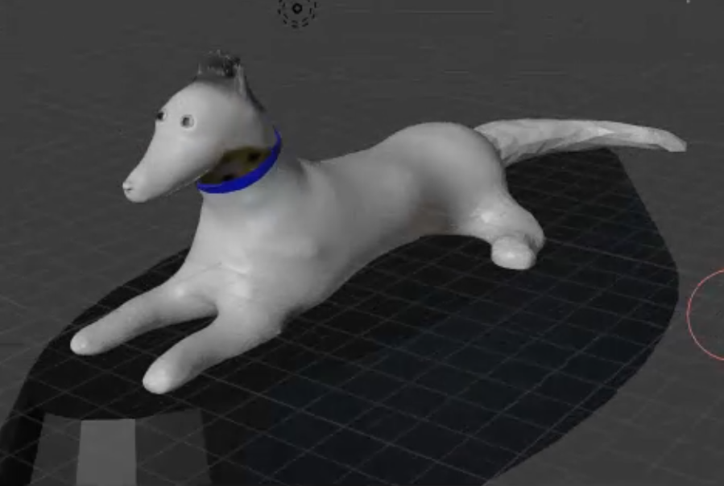

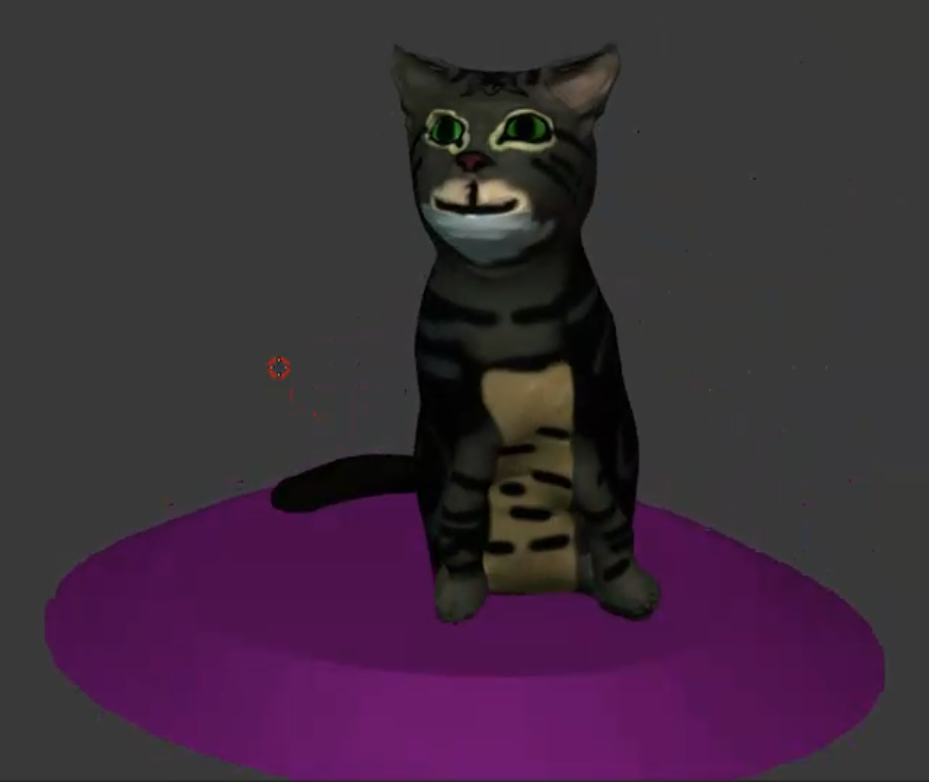

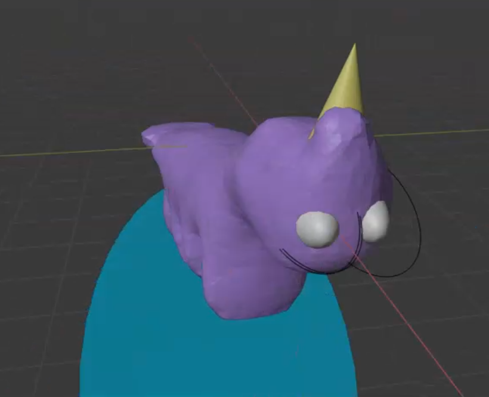

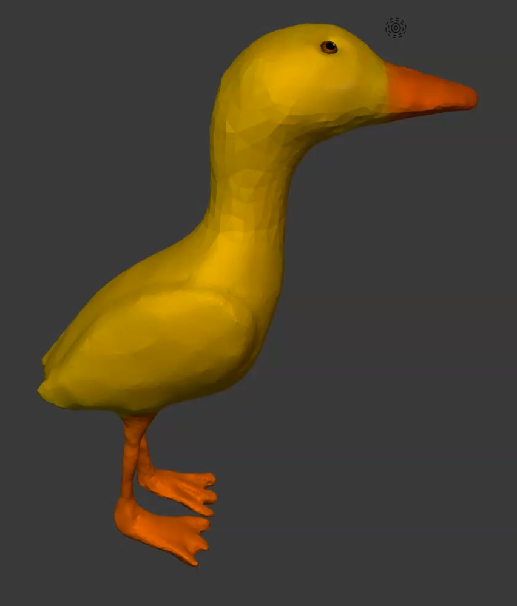

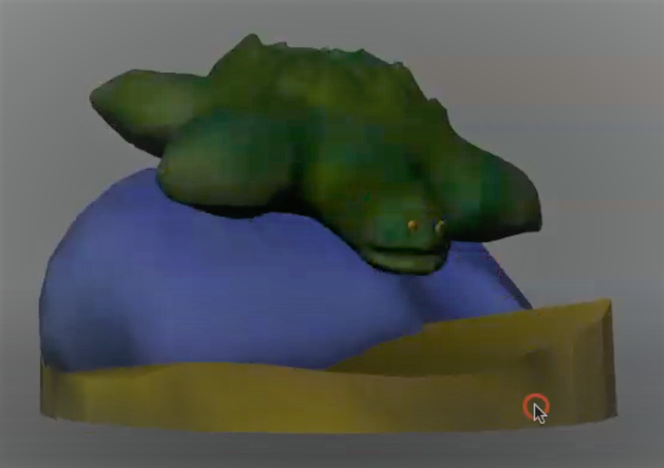

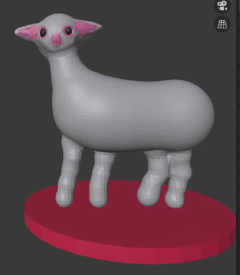

