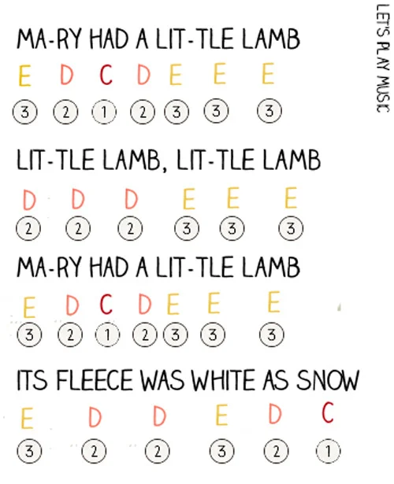

# Piezo Buzzer and Tone();






```
note    frequency    period    timeHigh
c       261 Hz       3830       1915 	
d       294 Hz       3400       1700 	
e       329 Hz       3038       1519 	
f       349 Hz       2864       1432 	
g       392 Hz       2550       1275 	
a       440 Hz       2272       1136 	
b       493 Hz       2028       1014	
C       523 Hz       1912        956
```


