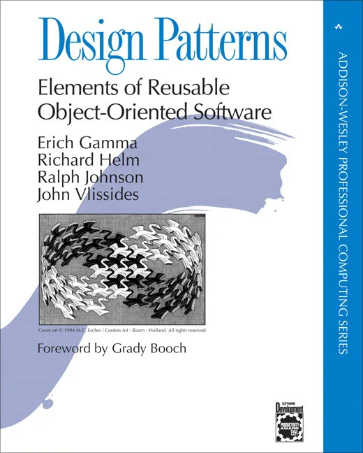

# Command Pattern

The Command pattern is the overall design that SolversLib uses. It's how we keep the code from becoming any more of a confusing mess than it already is — a pattern we can follow. This page delves into the "what" and "why" behind this pattern, equipping you to write efficient and maintainable robot code—the kind where Future You doesn't curse Past You's organizational choices.

[https://docs.seattlesolvers.com/](https://docs.seattlesolvers.com/)

## **What is Command Pattern?**

The Command pattern boasts a rich history dating back to the late 1970s and early 1980s. The concept emerged within the Smalltalk and Xerox PARC communities, documented in publications like Anneliese Schürr's 1992 paper "Separation of Concerns and the Command Pattern." Initially focused on graphical user interfaces (GUIs), the pattern's flexibility was adopted in various software development domains.

Its popularity soared with the rise of design patterns in the 1990s, solidified by Erich Gamma et al.'s influential book "Design Patterns: Elements of Reusable Object-Oriented Software." This widespread recognition cemented the Command pattern as a valuable tool for promoting loose coupling, reusability, and maintainability in object-oriented programming.

<figure><figcaption>
Gamma, Helm, Johnson and Vlissides are sometimes referred to as the Gang of Four or GoF
</figcaption></figure>

The Command pattern originates from software design principles and offers a structured way to manage robot actions. Instead of writing long, blocking code sections, you create independent classes called **Commands**. Each Command encapsulates your robot's specific task, like driving forward, turning, or activating a mechanism.

## **Why Command Pattern?**

### **Farewell, Blocking Code**

Traditional robot programming often involves lengthy, sequential code blocks, potentially hindering responsiveness and multitasking. If your robot is stuck inside of a loop that gradually moves a motor, it's not doing other things. It's blocked until you move on.

Non-blocking commands eliminate the need to do one thing at a time by repeatedly calling `execute` functions that run until their `isFinished` condition is reached. This allows the robot to perform multiple actions simultaneously. This means smoother operation and the ability to react to real-time events effectively.

### **Reusable Gems**

Commands are designed for reusability. You can create a generic `RotateCommand`and adapt it for different distances or speeds across various parts of your code. This reduces code duplication and simplifies maintenance.

### **Collaborative Codebase**

SolversLib encourages modularity with separate Command files. This translates to clear ownership and promotes a collaborative development environment. Team members can work on their specific Commands without worrying about conflicts in common code sections. Version control systems like Git become even more valuable as team members push their Command commits independently.

## **Utilities in SolversLib**

This toolkit is packed with stuff — way more than just commands (though they're still a big deal and I'm going to keep writing about them). Check out all the things:

**Command Management:**

* **Subsystem Framework**: Organize your robot's hardware into logical subsystems that own their resources and prevent conflicts.
* **Command Scheduling**: The scheduler handles command lifecycle, requirements, and interruptions automatically.
* **Command Composition**: Chain commands together, run them in parallel, or create complex sequences without callback chaos.

**Hardware Wrappers:**

* **Motor & Servo Control**: Simplified classes with built-in caching to reduce unnecessary hardware writes. Special support for Axon servos with absolute encoders.
* **Sensor Interfaces**: Wrappers for gyros, distance sensors, color sensors, and more.
* **Gamepad Extensions**: Enhanced button and trigger handling with intuitive methods like `wasJustPressed()` and `wasJustReleased()`.

**Movement & Navigation:**

* **Drivebase Classes**: Pre-built support for differential, mecanum, kiwi, and X-drive configurations with both robot-centric and field-centric control.
* **Kinematics & Odometry**: WPILib-style classes for tracking robot position using encoders and gyros across different drivetrain types.
* **Controllers**: PID, feedforward, and SquID control for precise mechanism movements.

**Utilities:**

* **Geometry Classes**: Pose2d, Translation2d, Rotation2d for coordinate math.
* **Look-Up Tables**: Store and retrieve tuned values (velocities, angles) based on distance or other inputs.
* **Timers & Math Helpers**: Built-in timing functions and utilities like clamp for value constraining.

**Pedro Pathing Integration:**

* Built-in support module for seamless integration with Pedro Pathing autonomous navigation.

## Video Overview


