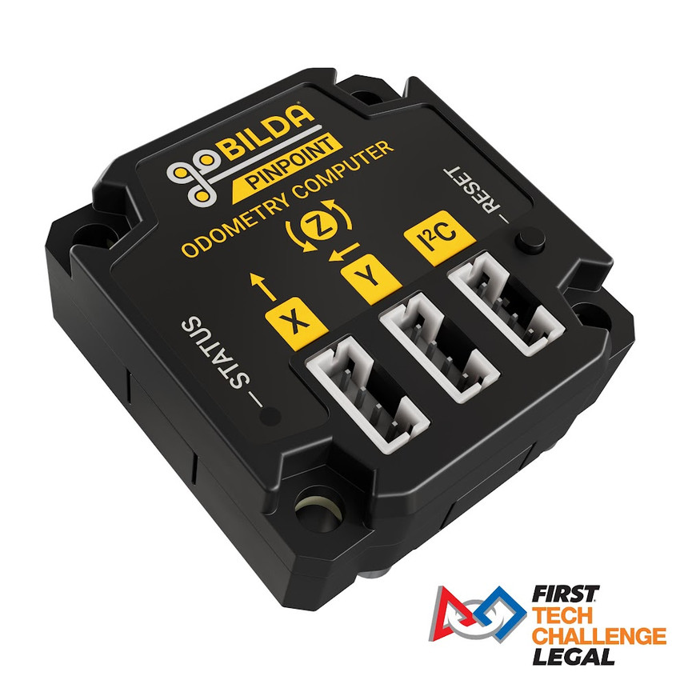

# Pedro's Follower

## **Where Pedro Came From**

Pedro Pathing is a pure pursuit path-following library explicitly built for FTC by Anyi Lin. Unlike older systems like RoadRunner that required extensive tuning and complex trajectory generation, Pedro takes a more straightforward approach: you give it waypoints, and it figures out how to smoothly drive between them. The library uses a follower system that continuously calculates motor powers to keep your robot on track, handling the math so you don't have to. It's become popular in the FTC community because it's easier to tune, more forgiving of imperfect robots, and plays nicely with modern odometry systems like the Pinpoint Computer.



## **Understanding the Coordinate System**

Pedro Pathing uses a specific coordinate plane that you'll need to internalize. Our team uses **Panels Dashboard** (accessible at `192.168.43.1:8001` when connected to your Control Hub) to visualize this coordinate system and tune paths in real-time.

Here's the critical detail: **On the Panels field map, zero heading (0 radians) points to the right**. This is different from what you might intuitively expect:

* **0 radians** = Robot facing right (positive X direction)
* **π/2 radians (90°)** = Robot facing up (positive Y direction)
* **π radians (180°)** = Robot facing left (negative X direction)
* **3π/2 radians (270°)** = Robot facing down (negative Y direction)

The coordinate system is supposed to span from (0, 0) at the bottom-left corner to (144, 144) at the top-right corner, matching the field dimensions in inches. However, if the Panels map behaves differently—such that hovering your mouse over the map gives you unexpectedly offset X and Y values—simply follow its coordinate plane instead. Playing nicely with the Panels map is more important than theoretical correctness; being able to see what your robot is thinking as it moves around the field makes debugging infinitely easier.

## **Integrating Pedro with Commands**

The shift from manual motor control to Pedro Pathing represents a fundamental change in how we think about driving the robot. Understanding this transition is crucial for writing effective autonomous commands and properly managing the follower system.

#### **The Old Way: Manual Motor Control**

Before Pedro, our `PedroDrive.drive()` function did everything manually:

1. Read joystick inputs (forward/strafe/turn)
2. Apply trigonometry for field-centric transformations
3. Calculate individual wheel powers for mecanum drive
4. Directly set motor powers: `frontLeft.setPower(power)`

This worked fine for teleop, but autonomous required us to write complex PID loops and path-following logic ourselves. Every movement command had to calculate velocities, handle acceleration curves, and monitor progress—lots of repeated code that was fragile and hard to tune.

#### **The New Way: Follower-Based Control**

With Pedro Pathing integrated, our `PedroDrive.drive()` function is dramatically simpler:

1. Read joystick inputs (forward/strafe/turn)
2. Pass them to the follower: `follower.setTeleOpMovementVectors(forward, strafe, turn)`
3. The follower handles field-centric transformations, calculates wheel powers, and applies them

The follower now does all the heavy lifting. Whether we're following an autonomous path or responding to joystick inputs, the follower calculates the appropriate motor powers and applies them. This unifies teleop and autonomous under a single control system.

#### **Commands Set Goals, Follower Achieves Them**

Here's the mental model you need: **Commands tell the follower what to do during `initialize()`, and the follower does it during the periodic updates.**

When you write an autonomous command:

* **In `initialize()`**: Build your path and tell the follower to follow it via `follower.followPath(path)`
* **In `execute()`**: Usually empty! The follower updates automatically in your drive subsystem's `periodic()` method
* **In `isFinished()`**: Check if the follower is done via `!follower.isBusy()`
* **In `end()`**: Clean up if interrupted

The key insight: **You don't drive the robot in your command's `execute()` method.** You set up the follower in `initialize()`, then let the subsystem's periodic method handle the actual driving. This is very different from old-style commands where `execute()` would continuously calculate and apply motor powers.

### **Critical: Breaking Following When Returning to TeleOp**

This is one of the most important concepts: **When transitioning from autonomous commands back to manual driving, you MUST call `follower.breakFollowing()`**.

Why? Because if the follower is still in "following a path" mode, it will fight against your joystick inputs. The driver tries to strafe left, but the follower says "no, I'm supposed to be holding this position!" and the robot behaves erratically or doesn't respond.

## **Example: FwdByDist.java**

Let's look at a practical command that moves the robot forward by a specific distance. This demonstrates how simple autonomous commands become when Pedro handles the heavy lifting:

```java
public class FwdByDist extends Command {
    private final PedroDrive drive;
    private final double distanceInches;
    private final double timeoutSeconds;
    private final ElapsedTime timer;
    private Path forwardPath;

    /**
     * Moves the robot forward by a specified distance
     * @param robot The robot instance
     * @param distanceInches How far to move (positive = forward)
     * @param timeoutSeconds Maximum time allowed for this movement
     */
    public FwdByDist(MyRobot robot, double distanceInches, double timeoutSeconds) {
        this.drive = robot.drive;
        this.distanceInches = distanceInches;
        this.timeoutSeconds = timeoutSeconds;
        this.timer = new ElapsedTime();
        
        // This command requires the drive subsystem
        addRequirements(drive);
    }

    @Override
    public void initialize() {
        // Get our current position
        Pose currentPose = drive.follower.getPose();
        
        // Calculate target position based on current heading
        // We're moving forward in the direction we're currently facing
        double targetX = currentPose.getX() + (distanceInches * Math.cos(currentPose.getHeading()));
        double targetY = currentPose.getY() + (distanceInches * Math.sin(currentPose.getHeading()));
        
        // Build the path: from where we are to our target
        forwardPath = new PathBuilder()
                .addPath(
                        // Start point (where we are now)
                        new BezierLine(
                                new Point(currentPose.getX(), currentPose.getY(), Point.CARTESIAN),
                                new Point(targetX, targetY, Point.CARTESIAN)
                        )
                )
                .setLinearHeadingInterpolation(currentPose.getHeading(), currentPose.getHeading())
                .build();
        
        // Tell the follower to follow this path
        drive.follower.followPath(forwardPath);
        timer.reset();
    }

    @Override
    public void execute() {
        // The follower updates automatically in the drive subsystem's periodic() method
        // We don't need to do anything here - Pedro handles it!
    }

    @Override
    public boolean isFinished() {
        // We're done when we've reached the end of the path OR timeout
        return !drive.follower.isBusy() || timer.seconds() > timeoutSeconds;
    }

    @Override
    public void end(boolean interrupted) {
        if (interrupted) {
            // Stop the follower if we were interrupted
            drive.follower.breakFollowing();
        }
        // Otherwise, Pedro has already stopped us at the target
    }
}
```

**Key Takeaways:**

1. **No direct motor control**: Notice we never call `motor.setPower()`. The follower calculates and applies all motor powers through `drive.follower.followPath()`.
2. **Path building in initialize()**: We construct the path right before executing, using the robot's current position. This makes the command reusable from any starting location.
3. **Follower does the work**: The `execute()` method is empty because the drive subsystem's `periodic()` method calls `follower.update()` automatically. The follower handles all the PID calculations, path following math, and motor power application.
4. **Simple completion check**: We just ask the follower if it's still busy. No need to manually check encoder values or calculate distances.
5. **Math.cos() and Math.sin()**: These trig functions convert our heading angle into X and Y components. Since heading 0 points right (positive X), moving "forward" means moving in the direction of our current heading.

**From Here to Everywhere**

This pattern extends to all autonomous movement commands:

* **Turn commands**: Change heading while staying in place
* **Strafe commands**: Move sideways relative to current heading
* **Complex paths**: Chain multiple waypoints with curves
* **Hold position**: Tell the follower to hold at the current pose

The follower system means you're always thinking in terms of "where should the robot be?" rather than "what motor powers do I need?" It's a much more intuitive way to program autonomous routines, and it makes your code easier to debug when things inevitably go sideways during competition.

## **PinPoint**

**What is Pinpoint?**

The Pinpoint Odometry Computer is a dedicated hardware module that handles all the heavy math for tracking your robot's position on the field. Think of it as your robot's GPS system—it constantly monitors wheel encoders and an IMU (Inertial Measurement Unit) to calculate exactly where the robot is and which direction it's facing. By offloading these calculations to dedicated hardware, your Control Hub can focus on running your actual code instead of burning cycles on trigonometry.

<figure><figcaption></figcaption></figure>

**Why We Upgraded**

Before Pinpoint, we were using standard 3-wheel odometry with encoders plugged directly into our Control Hub. This worked, but had limitations:

* **CPU overhead**: The Control Hub had to constantly poll encoders and calculate position updates
* **Timing issues**: Localization updates could lag behind the rest of the code
* **IMU integration**: Fusing gyro data with encoder readings required additional code complexity

The Pinpoint computer solves all of this by doing the sensor fusion internally. It reads from three odometry encoders (two parallel "tracking" wheels and one perpendicular wheel) plus its onboard IMU, then sends the Control Hub a clean, fused pose estimate over I2C. The IMU data is particularly valuable for catching wheel slippage—if the encoders say you turned 45° but the gyro says you only turned 30°, something slipped, and Pinpoint knows to trust the gyro.

### **Integration with Pedro Pathing**

Before running any autonomous paths, verify your localization is working:

1. **Push test**: Manually push your robot forward 12 inches. Does telemetry show it moved 12 inches?
2. **Rotation test**: Rotate the robot 90° by hand. Does the heading change by π/2 radians (1.57)?
3. **Strafe test**: If you have mecanum wheels, push the robot sideways. Do the X and Y coordinates change correctly?
4. **Spin test**: Spin the robot in circles. Does the heading wrap properly at ±π without jumping?

If any of these tests fail, you've got configuration issues to fix before attempting autonomous routines. Trust us—debugging bad localization _after_ your robot has already crashed into a wall is way harder than catching it beforehand.

## **Update Loop**

### **One Update Per Loop:**

In your `PedroDrive` subsystem (or whatever you've named your drive subsystem), there's a `periodic()` method that runs automatically every loop thanks to SolversLib's `CommandOpMode`. Inside this method, you'll find the most important line in your entire autonomous codebase:

```java
@Override
public void periodic() {
    follower.update();  // Update pose and calculate motor powers
    
    // Send telemetry to Panels
    drawRobotOnPanels();
}
```

That `follower.update()` call does three critical things:

1. **Reads the current pose** from your Pinpoint odometry computer
2. **Calculates where the robot should be** based on the current path or teleop inputs
3. **Applies motor powers** to get the robot there

Here's the absolutely critical part: **This method must be called exactly ONCE per loop. Not zero times. Not two times. ONCE.**

### **Why Multiple Updates Are Catastrophic**

Calling `follower.update()` multiple times in a single loop doesn't just slow things down—it actively corrupts your localization and makes your robot behave unpredictably. Here's why:

The follower's math depends on knowing how much time has passed between updates. When you call `update()` the first time, it reads the current pose, calculates velocities based on position change since the last update, and applies motor powers. If you call it again immediately:

1. **Time delta is wrong**: The follower thinks more time has passed than actually has
2. **Position hasn't changed yet**: Motors haven't had time to respond to the first update's commands
3. **Velocity calculations break**: Dividing near-zero position change by near-zero time gives garbage values
4. **Motor powers go haywire**: The follower thinks the robot isn't moving and applies maximum correction

The result? Your robot might spin in circles, overshoot targets wildly, or oscillate back and forth trying to correct for phantom errors.

#### **How to Avoid This Mistake**

The good news: **If you're using `CommandOpMode` and SolversLib subsystems properly, this is handled automatically.** The scheduler calls `periodic()` on each registered subsystem exactly once per loop. You don't need to call it manually.

**Common ways teams accidentally call update() multiple times:**

❌ **WRONG - Calling update() in your command:**

```java
@Override
public void execute() {
    robot.drive.follower.update();  // DON'T DO THIS!
    // The subsystem's periodic() will also call update()
}
```

❌ **WRONG - Calling a manual update method:**

```java
public void manualUpdate() {
    follower.update();  // Called somewhere else
}

@Override
public void periodic() {
    follower.update();  // Also called here - DOUBLE UPDATE!
}
```

✅ **CORRECT - Let periodic() handle it:**

```java
@Override
public void periodic() {
    follower.update();  // Only here, called automatically by scheduler
    drawRobotOnPanels();
}
```

✅ **CORRECT - Commands do nothing:**

```java
@Override
public void execute() {
    // Empty! Update happens automatically in periodic()
}
```


Commands could also use their execute loop to query sensors, move servos, and do other things while the follower drives the robot.


## **Drawing the Robot on Panels**

The Panels Dashboard isn't just useful for tuning—it's essential for debugging. Seeing where your robot _thinks_ it is versus where it _actually_ is can instantly diagnose localization problems. Here's how we visualize the robot:

```java
private void drawRobotOnPanels() {
    // Get current pose from follower
    Pose currentPose = follower.getPose();
    
    // Create telemetry packet for Panels
    TelemetryPacket packet = new TelemetryPacket();
    
    // Draw the robot as a rectangle with heading indicator
    packet.fieldOverlay()
        .setStroke("#3F51B5")  // Blue color
        .strokeCircle(currentPose.getX(), currentPose.getY(), 9)  // Robot body (9" radius)
        .setStroke("#FFC107")  // Yellow heading line
        .strokeLine(
            currentPose.getX(), 
            currentPose.getY(),
            currentPose.getX() + 12 * Math.cos(currentPose.getHeading()),
            currentPose.getY() + 12 * Math.sin(currentPose.getHeading())
        );
    
    // Add text telemetry
    packet.put("X Position", currentPose.getX());
    packet.put("Y Position", currentPose.getY());
    packet.put("Heading (rad)", currentPose.getHeading());
    packet.put("Heading (deg)", Math.toDegrees(currentPose.getHeading()));
    packet.put("Follower Busy", follower.isBusy());
    
    // Send to dashboard
    FtcDashboard.getInstance().sendTelemetryPacket(packet);
}
```

### **What You'll See:**

When you open Panels Dashboard in your browser, you'll see:

* **A blue circle** representing your robot's position on the field
* **A yellow line** extending from the circle showing which direction the robot is facing
* **Live coordinate values** updating as the robot moves
* **Path visualization** (if you're following a path, Pedro can draw it too)

### **Why This Matters:**

Real-world debugging scenario: Your robot should drive forward 24 inches but instead curves to the left. Looking at Panels, you see:

* The robot's X coordinate increases correctly
* But the Y coordinate also increases (shouldn't happen for pure forward motion)
* The heading line shows a slight rotation

This immediately tells you: your left-side encoder is reading incorrectly, or your encoder directions are swapped. Without the visualization, you'd be guessing. With it, the problem is obvious.

### **Updating the Visualization:**

Since `drawRobotOnPanels()` is called in `periodic()` right after `follower.update()`, the visualization updates automatically every loop. You get a smooth, real-time view of what the robot is doing. This is especially useful during autonomous when you can't see telemetry on the Driver Station—just pull up Panels on your laptop and watch the robot's digital twin navigate the field.

#### **Pro Tip: Draw Your Paths Too**

You can also draw your intended paths on Panels before running them:

```java
public void initialize() {
    // Build your path
    Path myPath = new PathBuilder()
        .addPath(new BezierLine(
            new Point(12, 84, Point.CARTESIAN),
            new Point(36, 84, Point.CARTESIAN)
        ))
        .build();
    
    // Visualize it on Panels
    TelemetryPacket packet = new TelemetryPacket();
    packet.fieldOverlay()
        .setStroke("#4CAF50")  // Green for path
        .setStrokeWidth(1);
    
    // Draw the path points
    for (PathPoint point : myPath.getPathPoints()) {
        packet.fieldOverlay().strokeCircle(point.getX(), point.getY(), 2);
    }
    
    FtcDashboard.getInstance().sendTelemetryPacket(packet);
    
    // Start following
    follower.followPath(myPath);
}
```

Now you can see both where the robot should go (green path) and where it actually is (blue circle). If they diverge, you know you have tuning or localization issues to address.

**Remember:**

* **One `follower.update()` per loop** - trust the subsystem's `periodic()` method
* **Visualize everything** - if you can see it, you can debug it
* **Panels is your friend** - when autonomous goes wrong at competition, having real-time visualization can save your event

The combination of proper update management and good visualization tools transforms autonomous programming from black magic into a systematic, debuggable process.

## Tuning

Pedro Pathing tuning can feel overwhelming, but you can break it down into manageable steps. Once you get through the initial setup, the system mostly just works. This guide will walk you through the essentials without drowning you in details.

#### **Before You Tune Anything**

Before touching any PID values, verify three fundamental things:

**1. Motor Directions Work Correctly**

Put your robot on a foam block (wheels off the ground) and run a simple teleop test. Drive forward, backward, left, and right. If any direction is wrong, fix the motor direction constants in `Constants.java`:

```java
public static final DcMotorSimple.Direction LEFT_FRONT_DIRECTION = DcMotorSimple.Direction.REVERSE;
public static final DcMotorSimple.Direction LEFT_BACK_DIRECTION = DcMotorSimple.Direction.REVERSE;
// etc...
```

**2. Weigh Your Robot**

Pedro needs the accurate mass (in kilograms) for centripetal force calculations. Use a bathroom scale: weigh yourself holding the robot, then subtract your weight. Update in `Constants.java`:

```java
public static FollowerConstants followerConstants = new FollowerConstants()
    .mass(9.979)  // Your measured value in kg
```

**3. Measure Odometry Pod Positions**

Measure (in millimeters) from your robot's center to each odometry pod. Update in `Constants.java`:

```java
public static PinpointConstants pinpointConstants = new PinpointConstants()
    .xOffset(-84.0)   // mm - forward/back position
    .yOffset(-168.0)  // mm - left/right position
```

These measurements are critical—wrong values make your robot think it's spinning when driving straight.

#### **The Tuning Sequence**

Pedro tuning must be done in order. Each controller builds on the previous one. Total time: **40-60 minutes** for a well-tuned system.

**Finding Variables in Panels:** Open Panels Dashboard at `192.168.43.1:8001`, then navigate to the **Configuration** tab. You'll see a large dropdown table—use Ctrl+F (or Cmd+F) to search for the specific variable names mentioned below. This makes finding the right setting much faster.


### WATCH THE VIDEOS CAREFULLY

Look at the small behaviors they're improving as they fiddle with the numbers on Panels

[https://pedropathing.com/docs/pathing/tuning](https://pedropathing.com/docs/pathing/tuning)




***

**Phase 1: Forward/Backward Tuner** _(5-10 minutes)_

Run the `ForwardZeroPowerAccelerationTuner` OpMode from your Tuning menu.

**What to tune:** `forwardZeroPowerAcceleration` in Panels\
**What to watch:** Robot should stop cleanly without sliding or overshooting\
**Update Constants.java:** Copy the value to `.forwardZeroPowerAcceleration()`

***

**Phase 2: Lateral Tuner** _(5-10 minutes)_

Run the `LateralZeroPowerAccelerationTuner` OpMode.

**What to tune:** `lateralZeroPowerAcceleration` in Panels\
**What to watch:** Robot should stop cleanly when strafing\
**Update Constants.java:** Copy the value to `.lateralZeroPowerAcceleration()`

***

**Phase 3: Forward Velocity Tuner** _(5-10 minutes)_

Run the `ForwardVelocityTuner` OpMode.

**What to tune:** `xVelocity` in Panels (search in the mecanum constants section)\
**What to watch:** Adjust until the displayed velocity matches your robot's actual max speed\
**Update Constants.java:** Copy the value to `mecanumConstants.xVelocity()`

***

**Phase 4: Lateral Velocity Tuner** _(5-10 minutes)_

Run the `LateralVelocityTuner` OpMode.

**What to tune:** `yVelocity` in Panels\
**What to watch:** Adjust until strafe velocity matches actual performance\
**Update Constants.java:** Copy the value to `mecanumConstants.yVelocity()`

***

**Phase 5: Translational PID** _(10-15 minutes)_

Run the `StraightBackAndForth` OpMode with only translational correction enabled.

**What to tune:** `translationalPIDFCoefficients` (search for this in Panels - start with P only)\
**What to watch:** Push robot sideways during movement—it should correct back smoothly without oscillating\
**Update Constants.java:** Copy P, I, D, F values to `.translationalPIDFCoefficients(new PIDFCoefficients(P, I, D, F))`

***

**Phase 6: Heading PID** _(10-15 minutes)_

Run the `StraightBackAndForth` OpMode with heading correction enabled.

**What to tune:** `headingPIDFCoefficients` (start with P, maybe add D)\
**What to watch:** Manually rotate the robot—it should correct back to target heading without spinning excessively\
**Update Constants.java:** Copy P, I, D, F values to `.headingPIDFCoefficients(new PIDFCoefficients(P, I, D, F))`

***

**Phase 7: Drive PID** _(10-15 minutes)_

Run the `StraightBackAndForth` OpMode with all corrections enabled.

**What to tune:** `drivePIDFCoefficients`\
**What to watch:** Robot should follow the path smoothly without weaving\
**Update Constants.java:** Copy values to `.drivePIDFCoefficients(new FilteredPIDFCoefficients(P, I, D, F, filterGain))`

***

**Phase 8: Centripetal Force** _(10-15 minutes)_

Run the `CurvedBackAndForth` OpMode.

**What to tune:** `centripetalScaling` (typical range: 0.001-0.01)\
**What to watch:** Does robot cut inside corners (increase value) or swing wide (decrease value)?\
**Update Constants.java:** Copy the value to `.centripetalScaling()`

***
