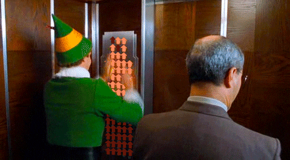

# Running Your Code

## **Starting Points**

From the little Android driver station, here's where we select our autonomous or teleop opModes. Our autonomous entry point can have some options to indicate where the robot is starting on the field and any decisions about scoring that need to be made.

```java
@Autonomous(name = "Autonomous - Primary")
public class AutoMcAutty extends CommandOpMode {
    /**
     * Set up robot such that it asks the player what our starting position is and kicks off
     * a SolversLib-style Pedro Pathing autonomous.
     */
    @Override
    public void initialize() {
        // QUERY USER TO DETERMINE OUR STARTING COORDINATES
        boolean isLeft = false;
        boolean isRed = false;
        boolean goForBoard = false;
        boolean gotoOpposite = false;
        // give player time to enter selection
        while(opModeInInit()) {
            // press X for blue and B for red
            if (gamepad1.x)
                isRed = false;
            else if (gamepad1.b && !gamepad1.start)
                isRed = true;
            // press dpad LEFT for left and RIGHT for right
            if (gamepad1.dpad_left)
                isLeft = true;
            else if (gamepad1.dpad_right)
                isLeft = false;
            // press Y to go for 45 and A just to park
            if (gamepad1.y)
                goForBoard = true;
            else if (gamepad1.a && !gamepad1.start)
                goForBoard = false;
            // DISPLAY SELECTION
            telemetry.addData("Position", "%s Team, %s Side", isRed ? "Red" : "Blue",
                    isLeft ? "Left" : "Right");
            telemetry.addData("Target Points", "%s", goForBoard ? "45" : "25");
            telemetry.update();
        }
        /*
         We build our robot. From here on out, we don't need this file. When we build the robot,
         all of our buttons are bound to commands and this class's parent, CommandOpMode, will
         continuously run any scheduled commands. We now slide into the WPILib style.
         We pass in our autonomous config variables, which signals to the robot we want to be in
         autonomous mode instead of in teleop mode, which would take no params besides this.
         */
        Robot m_robot = new MyRobot(this, isRed, isLeft, goForBoard);
    }
}
```

### The teleop kick-off is much simpler:

```java
@TeleOp(name="TeleOp - Primary")
public class DriveyMcDriverson extends CommandOpMode {

    /**
     * Autonomous is over. It's time to drive. No more tracking pose—just pure driving.
     */
    @Override
    public void initialize() {
        /*
         We build our robot. From here on out, we don't need this file. When we build the robot,
         all of our buttons are bound to commands and this class's parent, CommandOpMode, will
         continuously run any scheduled commands. We now slide into the WPILib style.
         */
        Robot m_robot = new MyRobot(this);
    }
}
```

These two opModes go to the same place but get there using different constructors. The robot knows whether to run autonomous or teleop based on which constructor is being called.

***

## **MyRobot**

This is where Commands get lined up for autonomous mode or bound to controller inputs in teleop. **MyRobot** is a soulless filename; we typically rename this file each year after our robot.

<div align="center"><figure><figcaption></figcaption></figure></div>

```java
public class MyRobot extends Robot {

    // INSTANCE VARIABLES
    public LinearOpMode opMode;
    public GamepadEx player1;
    public GamepadEx player2;
    public enum AprilTagToAlign {
        LEFT, CENTER, RIGHT, NONE
    }
    public AprilTagToAlign targetApril = AprilTagToAlign.NONE;

    // SUBSYSTEMS
    public MecanumDrive drive;
    public Arm arm;

    /**
     * Welcome to the Command pattern. Here we assemble the robot and kick-off the command
     * @param opMode The selected operation mode
     */
    public MyRobot(LinearOpMode opMode) {
        this.opMode = opMode;
        player1 = new GamepadEx(opMode.gamepad1);
        player2 = new GamepadEx(opMode.gamepad2);
        initTele();
    }
    // OVERLOADED CONSTRUCTOR THAT RESPONDS TO AUTONOMOUS OPMODE USER QUERY
    public MyRobot(LinearOpMode opMode, boolean isRed, boolean isLeft, boolean goForBoard) {
        this.opMode = opMode;
        initAuto(isRed, isLeft, goForBoard);
    }

    /**
     * Set teleOp's default commands and player control bindings
     */
    public void initTele() {
        // throw-away pose because we're not localizing anymore
        drive = new MecanumDrive(this, new Pose2d(0, 0, 0));
        register(drive);
        drive.setDefaultCommand(new DriveCommand(this));
        // start arm
        arm = new Arm(this);
        register(arm);

        /*
                .__                                      ____
        ______  |  |  _____   ___.__.  ____ _______     /_   |
        \____ \ |  |  \__  \ <   |  |_/ __ \\_  __ \     |   |
        |  |_> >|  |__ / __ \_\___  |\  ___/ |  | \/     |   |
        |   __/ |____/(____  // ____| \___  >|__|        |___|
        |__|               \/ \/          \/
        */
        Button aButtonP1 = new GamepadButton(player1, GamepadKeys.Button.A);
        aButtonP1.whenPressed(new InstantCommand(() -> {
            drive.toggleFieldCentric();
        }));

        Button bButtonP1 = new GamepadButton(player1, GamepadKeys.Button.B);
        bButtonP1.whenPressed(new InstantCommand(() -> {
            drive.resetFieldCentricTarget();
        }));

        Button xButtonP1 = new GamepadButton(player1, GamepadKeys.Button.X);
        Button yButtonP1 = new GamepadButton(player1, GamepadKeys.Button.Y);
        Button dPadUpP1 = new GamepadButton(player1, GamepadKeys.Button.DPAD_UP);
        Button dPadDownP1 = new GamepadButton(player1, GamepadKeys.Button.DPAD_DOWN);
        Button dPadLeftP1 = new GamepadButton(player1, GamepadKeys.Button.DPAD_LEFT);
        Button dPadRightP1 = new GamepadButton(player1, GamepadKeys.Button.DPAD_RIGHT);

        /*
                _                                    __
               (_ )                                /'__`\
         _ _    | |    _ _  _   _    __   _ __    (_)  ) )
        ( '_`\  | |  /'_` )( ) ( ) /'__`\( '__)      /' /
        | (_) ) | | ( (_| || (_) |(  ___/| |       /' /( )
        | ,__/'(___)`\__,_)`\__, |`\____)(_)      (_____/'
        | |                ( )_| |
        (_)                `\___/'
         */
        Button aButtonP2 = new GamepadButton(player2, GamepadKeys.Button.A);
        aButtonP2.whenPressed(new InstantCommand(() -> {
            arm.travelMode();
        }));

        Button bButtonP2 = new GamepadButton(player2, GamepadKeys.Button.B);
        bButtonP2.whenPressed(new InstantCommand(() -> {
            arm.toggleOpen();
        }));

        Button xButtonP2 = new GamepadButton(player2, GamepadKeys.Button.X);
        xButtonP2.whenHeld(new ArmMoveTo(this, ArmMoveTo.ArmPosition.GROUND));

        Button yButtonP2 = new GamepadButton(player2, GamepadKeys.Button.Y);
        yButtonP2.whenHeld(new ArmMoveTo(this, ArmMoveTo.ArmPosition.HIGH_DROP));

        Button dPadUpP2 = new GamepadButton(player2, GamepadKeys.Button.DPAD_UP);
        dPadUpP2.whileHeld(new InstantCommand(() -> {
            arm.wristUp();
        }));

        Button dPadDownP2 = new GamepadButton(player2, GamepadKeys.Button.DPAD_DOWN);
        dPadDownP2.whileHeld(new InstantCommand(() -> {
            arm.wristDown();
        }));

        Button dPadLeftP2 = new GamepadButton(player2, GamepadKeys.Button.DPAD_LEFT);
        dPadLeftP2.whileHeld(new InstantCommand(() -> {
            arm.rollNegative();
        }));

        Button dPadRightP2 = new GamepadButton(player2, GamepadKeys.Button.DPAD_RIGHT);
        dPadRightP2.whileHeld(new InstantCommand(() -> {
            arm.rollPositive();
        }));
    }

    /**
     * Used given starting position and call the corresponding commands
     */
    public void initAuto(boolean isRed, boolean isLeft, boolean goForBoard) {
        // Calculate pose for each of the four starting positions
        // CRITICAL: Pedro Pathing uses RADIANS for heading angles, not degrees!
        Pose2d start;
        // RED LEFT (facing forward = 0 radians)
        if(isRed && isLeft)
            start = new Pose2d(12.0, 84.0, Math.toRadians(0));
        // RED RIGHT (facing forward = 0 radians)
        else if(isRed)
            start = new Pose2d(12.0, 36.0, Math.toRadians(0));
        // BLUE LEFT (facing backward = π radians)
        else if(isLeft)
            start = new Pose2d(132.0, 60.0, Math.toRadians(180));
        // BLUE RIGHT (facing backward = π radians)
        else
            start = new Pose2d(132.0, 108.0, Math.toRadians(180));

        // Initialize drive subsystem with our starting pose
        drive = new MecanumDrive(this, start);
        register(drive);
        
        // Initialize arm subsystem
        arm = new Arm(this);
        register(arm);
        
        // Set up our persistent pose manager so teleop can pick up where we left off
        // This saves our final autonomous position to retrieve later
        PersistentPoseManager.savePose(start);

        // locate prop, drop piece, withdraw and straighten out
        new SequentialCommandGroup(
                new ScanForProp(this, 0, 20, 4),
                new TurnToProp(this, 1),
                new InstantCommand(() -> {
                    arm.openClaw();
                    opMode.sleep(25);
                    arm.travelMode();
                }),
                new StrafeByDistance(this, 0, -2, 0.5),
                new RotateToZero(this, 2),
                // Save our final pose before autonomous ends
                new InstantCommand(() -> {
                    PersistentPoseManager.savePose(drive.follower.getPose());
                })
        ).schedule();

    }
}
```

***

### **Two Constructors**

One for teleop, requiring only the opMode object. Another for autonomous, taking additional parameters so we know our starting position and what script to run (`isRed`, `isLeft`, `goForBoard`).

***

#### **initTele**

**Default Command**

Once our drive train `drive` is registered, we give it a default command, `DriveCommand`.

<figure><figcaption></figcaption></figure>

`defaultCommand` is a special command assigned to a subsystem that continuously runs unless interrupted by another higher-priority command.

* The `DriveCommand` will constantly watch joystick inputs as well as apply dead zones and field-oriented drive.
* If you press a button that triggers another command for the drive system (e.g., rotating), that command will interrupt the `DriveCommand` current command temporarily until it finishes.
* Once the other command finishes, the `DriveCommand` automatically resumes as the `defaultCommand`, listening to joystick inputs again.

**Keybindings**

The MyRobot code demonstrates different ways to connect gamepad buttons with robot actions using SolversLib. Here's a breakdown of the standard methods and how they translate to gameplay scenarios:

**1. whenPressed:**

* **Definition**: Executes a command once when the button is initially pressed.
* **Example**: Pressing the A button on Gamepad 1 toggles the driving mode.
* **FTC Gameplay**: Use this for actions that only need to happen once per button press, like switching drive modes or triggering a quick mechanism movement.

**2. whenReleased:**

* **Definition**: Executes a command once when the button is released.
* **Example**: Releasing the B button on Gamepad 2 closes the arm claw.
* **FTC Gameplay**: This is useful for actions that occur when you stop pressing the button, like stopping arm movement or ending a special ability.

**3. whileHeld:**

* **Definition**: Continuously executes a command while the button is held down.
* **Example**: Holding the d-pad on Gamepad 2 raises or lowers the arm's wrist.
* **FTC Gameplay**: Perfect for incremental adjustments where you want continuous control over the duration of the button press.

<figure><figcaption></figcaption></figure>

**4. toggleWhenActive:**

* **Definition**: Starts/stops a command each time the button is pressed, regardless of previous state.
* **Example**: Not used in the provided code, but it could be used for toggling a light or other on/off functionality.
* **FTC Gameplay**: This is helpful for quickly activating and deactivating abilities without keeping the button held down.

Here's an example of how to link a button with a command using `whileHeld`:

```java
Button dPadUpButton = new GamepadButton(gamepad2, GamepadKeys.Button.DPAD_UP);
dPadUpButton.whileHeld(new InstantCommand(() -> {
    arm.wristUp();
}));
```

This code creates a button listener for the up d-pad on Gamepad 2. When held down, it continuously executes a command that raises the arm's wrist.

***

### **initAuto**

In MyRobot's `initAuto` function, the autonomous script takes shape. But how do you structure your commands? Let's delve into the options:

**Pedro Pathing Poses: The Radian Reality**

Before we dive into command structures, there's a critical detail: **Pedro Pathing uses radians for heading angles, not degrees**. When setting up your starting poses, always use `Math.toRadians()` to convert from the degrees you're thinking in to the radians Pedro expects. Missing this conversion is a classic mistake that'll have your robot spinning in completely wrong directions.

We also use a `PersistentPoseManager` to save our robot's position at the end of autonomous. This means when teleop starts, you could theoretically pick up exactly where autonomous left off—though most teams just throw this away and start with a fresh `Pose2d(0, 0, 0)` for driving.

**1. Sequential Commands:**

Commands execute one after another, completing before the next starts. Think of it as a step-by-step recipe: scan for the prop, turn towards it, open the claw, move closer, etc.

**Benefits:**

* Easy to understand and troubleshoot.
* Ensures each action finishes cleanly before proceeding.

**Drawbacks:**

* Might be slower if some actions could happen simultaneously.
* Less flexibility for complex maneuvers involving interactions or timing dependencies.

**2. Concurrent Commands:**

Multiple commands run simultaneously, sharing resources and potentially interacting dynamically. Imagine multitasking: turning while moving closer or raising the wrist while opening the claw.

**Benefits:**

* Can be more efficient if actions don't rely on each other's completion.
* Offers greater flexibility for intricate robot behaviors.

**Drawbacks:**

* Requires careful planning to avoid conflicts and ensure smooth coordination.
* Debugging can be more challenging—like trying to fix a juggling routine mid-performance.

**Writing the Script:**

`initAuto` provides flexibility:

* **Within initAuto**: You can build your entire autonomous sequence directly in our robot file using a `new SequentialCommandGroup()` with nested commands. This approach keeps everything centralized and concise.
* **Separate File**: Files are kept shorter if we keep the autonomous procedure in its own `SequentialCommandGroup` file. This means a programmer tasked with this job could push changes to our GitHub repo with less concern for merge conflicts. 🤝
