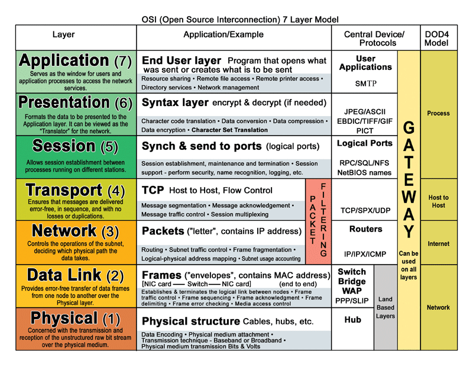
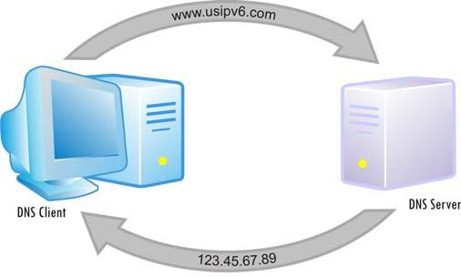

# 1: What's the Internet?

## Expectations

### Learning Targets

* I can describe a brief history of the Internet's origin and impact.
* I can write a professionally formatted email.

### Assessments

* You will receive comprehension questions about why the Internet was made, the very basics of its technology, how the technology grew, and its significance to society.
* You will send a professional email ([check against this guide](https://www.grammarly.com/blog/professional-email-in-english/)) taking a position on whether the Internet is a basic human right.
* (Codecademy) Get started on the [first HTML unit](https://www.codecademy.com/learn/learn-html)



## The Idea

**The Internet is mankind's greatest achievement.**\
Mr. Adiletta takes a dramatic position on the Internet as a basic human right. The evolution of human intelligence goes beyond the growth of our brain. and into the development of communal stories, into libraries, and then into the Internet. The Internet is a product of human evolution and is the birthright to all people.

The Internet is a part of your mind and you have the right to use your brain.

### Why was the Internet created?

During the height of the Cold War, the threat of a Soviet attack motivated the funding of a research project to build a web of communications lines. In such a network, if one line was cut by an attack, communications would proceed uninterrupted through alternate lines in the network. The beginnings of our [TCP/IP network](https://en.wikipedia.org/wiki/Internet_protocol_suite) was produced.

<figure><figcaption>
Afraid of phone lines disrupted in a nuclear war, the military funded research of a decentralized network
</figcaption></figure>

### Did Al Gore create the Internet?



In his 2000 Presidential campaign, Al Gore rightly took some credit in the creation of the Internet. No, he did not help develop the TCP/IP network. However, after the ARPANET project was complete, the ownership of the underlying technology was in question. It was offered for sale to at least one telecommunications company but they passed on buying the Internet not knowing what it would be good for. Al Gore was a part of a congressional effort to make TCP/IP a public resource. No one owns the Internet because of that. He also helped establish support to connect people--something we have a moral obligation to continue.

### Significance of the Internet

#### Why is this video funny?



After watching this video, take a moment to think about why this video seems silly. It's not just her rockin' hair and vest or the British perspective of the American president. It may be the many, giant screens. But more specifically it's how the changing technology has changed our impressions. She talks about shopping on the internet as a _future possibility_ and not something that everyone does like it's no big deal. Again, take a moment to understand that the Internet is a big deal.

#### The Internet has a physical component that must be appreciated, too.



## Vocabulary

* **OSI model:** The basis of the Internet. This describes how the TCP/IP network started by the Defense Department has evolved.

<figure><figcaption>
Pretty complicated, right? You don't need to memorize any of this for this class.
</figcaption></figure>

* **Internet Protocol (IP)**: A system for addressing and routing communication over a network. You can make up all the addresses you want on a private network, but the [IANA](https://www.iana.org/) is the authority of the public's IPs and domains.
* **Domain Name System (DNS):** A sort of phone book that changes or resolves domain names into IP addresses
  * **A Record**: routes primary domains like google.com
  * C Record: routes subdomains like **mail**.google.com
  * MX Record: routes email addresses. That's why emails @gilmour.org go to a different server than what's hosting the website at gilmour.org

<figure><figcaption></figcaption></figure>

## Further Exploration

There are many free tools that help you learn about domains. These are very helpful for web designers as you may want to check on the current host of a client interested in a site redesign. Try looking up the record of a few domains using one of these tools:

* [https://intodns.com/](https://intodns.com/)
* [http://whois.domaintools.com/](http://whois.domaintools.com/)
* [https://www.whatsmydns.net/](https://www.whatsmydns.net/)
