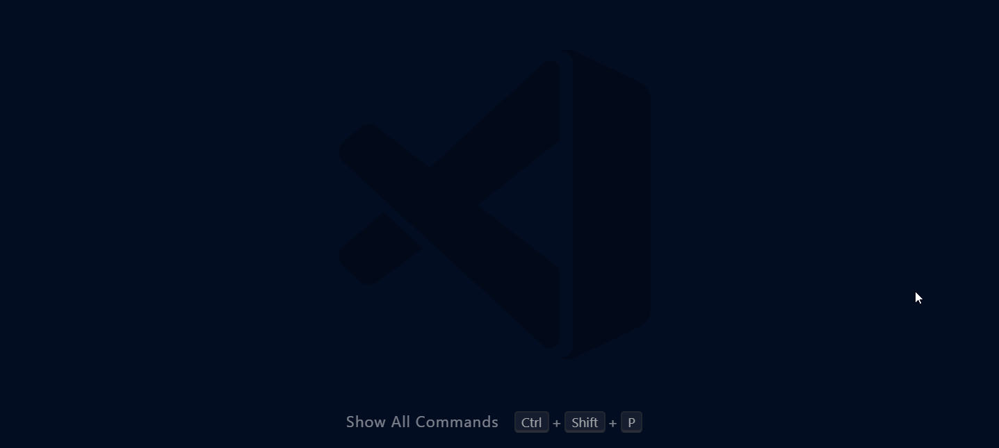

# 4: Install Flaskinni

## Learning Target

* I can run Flaskinni after having cloned its code, configured its dependencies in a virtual environment, set up a database, and added an environmental variables file.&#x20;

## Install Party

A day before some hackathons or events like [RailsBridge](http://railsbridge.org/), experts will host a session to help everyone install the tools they'll need. If you serve pizza, you can call pretty much anything a party.

### Your OS

Whether you're using Windows, macOS, or Linux, you have a responsibility to your teammates that you keep your machine updated and organized. Run system updates, keep files off your desktop, have a system of organizing your project files.  Knock this out early so it doesn't jam you up while installing complex programming tools.

### Dev Tools

Go slowly. Go patiently. Things may not work. You **will** have to Google stuff, study, maybe ask for help, and solve your problems. Keep hacking at the problem. That's how we all learn best.&#x20;

####

#### Python

Your computer only understands Python code through a [compiler ](https://en.wikipedia.org/wiki/Compiler)or [interpreter](https://en.wikipedia.org/wiki/Interpreter_\(computing\)). Your computer uses bytecode to run the software. Our interpreter changes our beautiful Python code into a jumble of machine instructions. Ensure you use the same version in development as you do in production. That means if your server will run, say, Python 3.10, that's what you use to build the thing.&#x20;


What version should you install? Whichever is the most stable on an Ubuntu server.&#x20;


#### Postgres

This is the open-source database tool we're going to use. You'll set up Postgres to host your own private database. It won't be available outside of your computer. It's just so while you work on an app, it can access a practice source of information.&#x20;




**Remember `postgres` password.** Since my computer's database is only used for building and testing apps, I set the password also to `postgres`


####

#### Git / GitHub

Mac users should have [Xcode ](https://apps.apple.com/us/app/xcode/id497799835?mt=12)and run `xcode-select --install` in their terminals. Windows users need to install [Git for Windows](https://git-scm.com/download/win). This gives you the commands to clone a repository, manage your changes to code, and sync&#x20;



####

#### NPM

Once upon a time, Javascript was just used to make pictures slowly spin on a webpage. Now we've got NodeJS letting this language that used to be purely stuck inside a web browser to now run independently on your computer. It's so popular, the [npm](https://www.npmjs.com/) tool to quickly install awesome new Node packages is a must-have.&#x20;




#### Choco & Brew

Node Package Manager often encourages the installation of amazing CLI installers like `choco` or `brew` (Mac and Windows respectively). So if you like quickly installing awesome things and can accept the responsibility to do so safely, get one!

[https://chocolatey.org/](https://chocolatey.org/) (Windows)\
[https://brew.sh/](https://brew.sh/)  (Mac)


####

#### Scss

Old-school CSS is a pain to program at a large scale. Sass is much more powerful. Your computer has to have it to run the [WebAssembly ](https://webassembly.org/)service built into Flaskinni. If you've got Choco or Brew installed, adding Sass is a breeze.&#x20;



### Editor

#### VS Code



I recommend these extensions

* [Cyberpunk theme](https://marketplace.visualstudio.com/items?itemName=Endormi.2077-theme)
* [Custom icons](https://marketplace.visualstudio.com/items?itemName=PKief.material-icon-theme) (they make it much easier to see your files)
* [Better Jinja](https://marketplace.visualstudio.com/items?itemName=samuelcolvin.jinjahtml)
* [DotENV](https://marketplace.visualstudio.com/items?itemName=mikestead.dotenv)
* [Python Auto Env](https://marketplace.visualstudio.com/items?itemName=whinarn.python-auto-venv)

## Setup Code

You can edit your code on the cloud with cool sites like [SourceLair](https://sourcelair.com). A cloud-based IDE is likely going to be based on Linux. That means you'll need to know a bit about [Linux CLI](https://ubuntu.com/tutorials/command-line-for-beginners#1-overview).  Linux plays well with coders and a cloud-based IDE makes it easy to share your development progress with people and get feedback faster. That's big.&#x20;

You can also set up right on your computer. You should know how to do this just so you can practice putting all the pieces together. I prefer to program in the cloud and locally and use [GitHub](https://desktop.github.com) to keep the two environments in sync.

### &#x20;Clone the repo

Use VS Code's git tool to pull down the repo from GitHub.com: `https://github.com/dadiletta/flaskinni`



### Stand up the db

"Stand up" a database just sounds so much cooler than "set up," but it's the same idea. You can see in `settings.py` that Flaskinni by default is going to reach out to a PSQL database named `db-flaskinni` on the server  `0.0.0.0`. The username and password used to access the database are also loaded there. Changes to this information shouldn't be done in `settings.py` but rather a `.env` fille. But before we do any of that, fire up pgAdmin and create a database.&#x20;



### Env variables

Our `.env` file doesn't and shouldn't ever get synced to GitHub. It's our secure place to keep the unique variables for each environment where our app will run.&#x20;



```python
###################
##  FLASK 
###################
FLASK_ENV=development
FLASK_APP=main
DEBUG=True 
SECRET_KEY='XXXXXXXXXXXXXXXXXXXXXXXXXXXXXXXXXXXXX'

###################
##  FLASKINNI  
###################
# DO NOT STORE A PASSWORD IN AN .ENV WITHIN PRODUCTION. SERIOUSLY UNSAFE
STARTING_ADMIN_PASS = 'flaskinni' 
ADMIN_EMAIL='flaskinni@gmail.com'
MAX_CONTENT_LENGTH = 2048 * 2048
UPLOAD_EXTENSIONS = ['.jpg', '.png', '.gif']

###################
##  SQLAlchemy 
###################
# Windows users change this to 127.0.0.1
DB_HOST=0.0.0.0 
DB_USERNAME='postgres' 
DB_PASSWORD='postgres' 
DB_PORT='5432'
DATABASE_NAME='db-flaskinni'
SQLALCHEMY_TRACK_MODIFICATIONS=False

###################
##  FLASK-SECURITY 
###################
SECURITY_REGISTERABLE=True
SECURITY_CONFIRMABLE=True
SECURITY_RECOVERABLE=True  
SECURITY_POST_LOGIN_VIEW='/'
SECURITY_EMAIL_SENDER='flaskinni@gmail.com'
SECURITY_PASSWORD_HASH ='pbkdf2_sha512'
SECURITY_PASSWORD_SALT = 'XXXXXXXXXXXXXXXXXXXXXXXXXXXXXXXXX'

###################
##  FLASK-MAIL
###################
MAIL_SERVER='sandbox.smtp.mailtrap.io'
MAIL_PORT=2525
MAIL_USE_SSL=False
MAIL_USE_TLS=True
MAIL_USERNAME='xxxxxxxxx'
MAIL_PASSWORD='xxxxxxxxxxx'
MAIL_DEFAULT_SENDER='flaskinni@gmail.com'

###################
##  JWT 
###################
PROPAGATE_EXCEPTIONS = True
JWT_BLOCKLIST_TOKEN_CHECKS = ['access', 'refresh']
```



### Virtual env

First you use the correct version of Python to launch its **venv** module to create a folder for our dependencies (also named **venv**):

* Windows: `python -m venv venv`
* Mac: `python3 -m venv venv` (as of this writing, Mac still comes with now-defunct Python2, so you need to distinguish between them)


Let's say you're using Windows and you need to specify a non-default version of Python. You may need a line like:`/c/Users/smithj/AppData/Local/Programs/Python/Python3XX/python -m venv venv`


Then we **activate the virtual environment** so all our required "expansion packs" or dependencies will be installed in our little bubble: &#x20;

* Mac: `source venv/bin/activate`
* Windows: (might need) `Set-ExecutionPolicy Unrestricted -Scope Process`\
  `.\venv\Scripts\activate`
* Windows (using bash instead of default Powershell): `source venv/Scripts/activate`

If you've got a happy little _`(venv)`_ before your terminal prompt, you're ready to run:\
`pip install -r requirements.txt`


Did one of the dependencies listed in `requirements.txt` fail to install correctly? It's a common problem that must be solved. uWSGI doesn't need to be installed in the development environment so you can `#comment` that line out. If psycopg2 is failing to install, you can comment that out and manually install the binary alternative, `pip install psycopg2-binary`. Running `pip install wheel` may also resolve many of the installation issues.



You're likely going to end up with the wrong version of Flask-Security. So next run:\
`pip uninstall flask-security`

`pip uninstall flask-security-too`

`pip install flask-security-too`


### Flask run

After running `flask run` in VS Code, you should be able to visit [http://127.0.0.1:5000](http://127.0.0.1:5000) to see your website.&#x20;

### Migrations

This is important! Pity the poor programmers that forget to set up their migration tools. Once Flaskinni is up and running the first time, run `flask db init` to allow Flask-Migrate to help with any future changes to your models. We'll talk about [why that's super important later](https://gilmour.online/compsci/web-development/flaskinni-drills#migrate-and-upgrade-the-right-way).&#x20;

### Alternate setups

#### Replit

Help! I don't know how to configure Replit's database service with SQLAlchemy. Their technical support doesn't know how to do it. They point me to [the forums](https://replit.com/talk/ask/Struggling-to-configure-my-flask-projects/122956)... and those folks can't crack it, either.&#x20;

#### Docker

I need to study up on Docker. These are notes that I'll use to redo this section later. Trying new stuff is important, even if you're not moving it into your stack. Docker represents a booming growth in containers, and that's something serious web dev folks need to deploy at scale.

1. Make sure [Docker ](https://www.docker.com/)is installed, running, and logged in.
2. Clone [Flaskinni](https://github.com/dadiletta/flaskinni)\
   `git clone http://github.com/dadiletta/flaskinni`
3. Edit the `Dockerfile` with environmental variables&#x20;
4. `docker-compose up --build`



#### What if it's not working?

You're going to get stuck... a lot. This is where you can distinguish yourself as a programmer. Every problem big and small you hack your way through makes you more legit. So enjoy the grind. It's important to read _around_ the problem and not just through it.  Sloppy copying from StackOverflow once you copy and paste the error into Google can get you in trouble. Get background research done to understand some of the bigger concepts. Be willing to reach out for help, but respect that other people are grinding away too. Always show evidence of your research when asking for help as it will build trust with your support network.&#x20;


